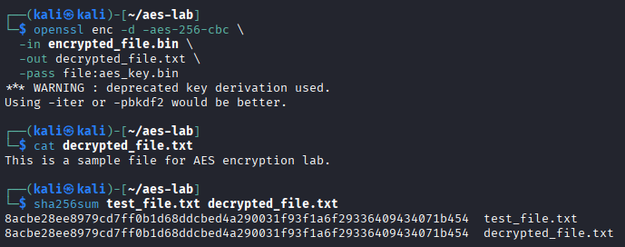
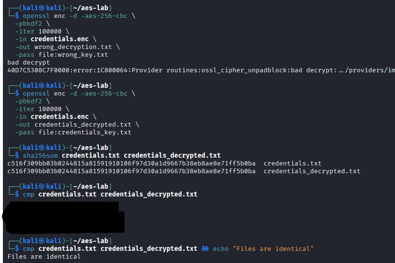

# AES-256 File Encryption and Validation with OpenSSL

## Executive Summary

This investigation demonstrates symmetric file encryption and decryption using OpenSSL and AES-256-CBC.

The exercise began with a guided encryption workflow, including secret generation, ciphertext inspection, decryption, and recovery verification.

An independent investigation extended the workflow to protect a simulated credentials file. The encryption process was improved using PBKDF2 with 100,000 iterations, followed by ciphertext inspection, an incorrect-key decryption test, and byte-for-byte recovery validation.

The investigation focused on understanding how encryption protects data confidentiality, how password-based key derivation affects an implementation, and why successful decryption should be verified rather than assumed.

## Investigation Scope

The work was conducted in an authorized Linux lab environment using OpenSSL and synthetic test data.

| Component | Implementation |
| --- | --- |
| Encryption algorithm | AES-256 |
| Cipher mode | CBC |
| Tool | OpenSSL |
| Guided exercise | Salted, password-based file encryption |
| Independent exercise | PBKDF2 with 100,000 iterations |
| Verification | SHA-256, `cmp`, `file`, `xxd`, `strings`, and `grep` |
| Test data | Sample plaintext and simulated credentials |

### Investigation Objectives

1. Encrypt and decrypt files using AES-256-CBC.
2. Inspect an encrypted artifact and identify its OpenSSL salted-file structure.
3. Verify that decryption reproduces the original file.
4. Identify and address the deprecated key-derivation warning encountered in the guided exercise.
5. Apply PBKDF2 to derive encryption material from separately stored passphrase material.
6. Test whether recognizable plaintext appears in the ciphertext.
7. Evaluate the limitations of encryption without authenticated integrity protection.

## Evidence Sources and Methodology

### Evidence Sources

The investigation used OpenSSL command output, encrypted-file inspection, cryptographic hashes, and file-comparison results.

Three screenshots preserve selected results from the guided and independent exercises.

### Investigation Methodology

| Phase | Analyst Activity |
| --- | --- |
| Preparation | Create synthetic plaintext and generate secret material |
| Encryption | Encrypt the original file using AES-256-CBC |
| Inspection | Examine the encrypted file's format and visible content |
| Decryption | Recover the original file using the appropriate secret |
| Verification | Compare SHA-256 hashes and file contents |
| Improvement | Replace deprecated password-based key derivation with PBKDF2 |
| Negative testing | Attempt decryption with incorrect secret material |
| Assessment | Document confidentiality observations and security limitations |

### Evidence Standards

The analysis distinguishes successful encryption operations from broader security guarantees.

The presence of an OpenSSL salted-file header and apparently unreadable ciphertext does not independently prove that an encryption implementation is secure.

Matching SHA-256 hashes and a successful `cmp` comparison demonstrate that the recovered file matched the original during the test.

An unsuccessful incorrect-key decryption attempt does not establish authenticated encryption. AES-CBC alone does not detect all unauthorized ciphertext modifications.

## Investigation Organization

The report documents three findings:

1. AES-256-CBC Encryption and Ciphertext Inspection
2. Decryption and File Recovery Verification
3. Independent PBKDF2 Encryption and Validation

The final sections will summarize the security implications, evidence limitations, skills demonstrated, and supporting screenshots.

## Investigation Findings

### Finding 1 — AES-256-CBC Encryption and Ciphertext Inspection

#### Investigation Context

The first exercise examined file encryption using OpenSSL and AES-256 in Cipher Block Chaining (CBC) mode.

The objective was to encrypt a plaintext file, inspect the resulting encrypted artifact, and determine what information could be observed without decrypting it.

#### Encryption Procedure

I encrypted a sample text file using OpenSSL:

```bash
openssl enc -aes-256-cbc -salt \
  -in test_file.txt \
  -out encrypted_file.bin \
  -pass file:aes_key.bin
```

The command used AES-256-CBC, enabled salting, and read password material from `aes_key.bin`.

The `-pass file:` option supplies passphrase material for OpenSSL's password-based key derivation. It does not directly load a raw AES-256 encryption key.

#### Encrypted File Inspection

Following encryption, I inspected the original and encrypted files.

| Field | Observed Result |
| --- | --- |
| Original file | `test_file.txt` |
| Original file size | 46 bytes |
| Encrypted file | `encrypted_file.bin` |
| Encrypted file size | 64 bytes |
| File identification | `openssl enc'd data with salted password` |
| Hex inspection command | `xxd encrypted_file.bin` |
| Header | `Salted__` |
| Header bytes | `53616c7465645f5f` |


*Figure 1 — OpenSSL AES-256-CBC encryption of a sample file, showing the deprecated key-derivation warning, file-size comparison, salted file identification, and `Salted__` header in the hexadecimal output.*

The encrypted file began with OpenSSL's `Salted__` marker, followed by salt bytes and ciphertext.

The encrypted artifact was larger than the original because the OpenSSL salted format includes an 8-byte marker, an 8-byte salt, and block-aligned encrypted data.

The hexadecimal inspection showed that the output was not stored as ordinary readable plaintext.

However, a salted header and unreadable bytes alone do not prove that the encryption configuration is secure.

#### Key-Derivation Warning

During encryption, OpenSSL displayed the following warning:

```text
*** WARNING : deprecated key derivation used.
Using -iter or -pbkdf2 would be better.
```

The command used OpenSSL's legacy password-based derivation behavior rather than explicitly enabling PBKDF2.

This warning identified an improvement opportunity addressed in the independent investigation.

#### Security Relevance

Symmetric encryption helps protect stored information against unauthorized disclosure when suitable algorithms, key derivation, and secret-management practices are used.

File inspection can help identify whether an artifact was processed by an encryption utility and what format was produced.

Nevertheless, confirming an encrypted file format does not independently establish confidentiality against every threat or provide ciphertext integrity protection.

#### Analyst Assessment

**Assessment: AES-256-CBC encryption successfully produced an OpenSSL salted ciphertext artifact.**

The original 46-byte plaintext file was converted into a 64-byte encrypted artifact containing the OpenSSL salted-file header.

The encryption command also generated a deprecated key-derivation warning, motivating the subsequent PBKDF2 implementation.

### Finding 2 — Decryption and File Recovery Verification

#### Investigation Context

The second exercise focused on recovering the original plaintext from an AES-256-CBC encrypted file.

The objective was to confirm that the correct passphrase material could successfully decrypt the ciphertext and to verify that the recovered file matched the original.

#### Decryption Procedure

I decrypted the previously generated ciphertext using OpenSSL:

```bash
openssl enc -d -aes-256-cbc \
  -in encrypted_file.bin \
  -out decrypted_file.txt \
  -pass file:aes_key.bin
```

The command used the same AES cipher mode and passphrase source as the encryption operation.

OpenSSL displayed the same deprecated key-derivation warning observed during encryption, confirming that the guided workflow continued to use the legacy password-based derivation method.

#### Plaintext Recovery

After decryption, I inspected the output file:

```bash
cat decrypted_file.txt
```

The recovered contents were:

```text
This is a sample file for AES encryption lab.
```

The successful recovery demonstrated that the ciphertext could be decrypted using the appropriate passphrase material.

#### SHA-256 Verification

To verify the recovered file, I calculated SHA-256 hashes for the original and decrypted files:

```bash
sha256sum test_file.txt decrypted_file.txt
```

Both files produced the same SHA-256 digest:

```text
8acbe28ee8979cd7ff0b1d68ddcbed4a290031f93f1a6f29336409434071b454
```

| File | Verification Result |
| --- | --- |
| `test_file.txt` | Original reference file |
| `decrypted_file.txt` | Matching SHA-256 digest |
| Comparison | No content differences detected by hash comparison |



*Figure 2 — OpenSSL AES-256-CBC decryption showing successful plaintext recovery and identical SHA-256 hashes for `test_file.txt` and `decrypted_file.txt`. The deprecated key-derivation warning remained present.*

Matching cryptographic hashes provide strong evidence that the recovered file was identical to the original during this test.

This verification was performed after decryption and should not be confused with authenticated encryption or automatic ciphertext-integrity protection.

#### Security Relevance

File encryption must be paired with reliable recovery procedures to ensure that protected information remains usable by authorized users.

Verifying decrypted output helps identify incorrect secret material, corrupted data, and unexpected changes during the encryption/decryption workflow.

However, AES-CBC encryption does not independently provide authenticated integrity protection. The successful file comparison demonstrates recovery in this controlled exercise, not resistance to malicious ciphertext modification.

#### Analyst Assessment

**Assessment: Original plaintext successfully recovered and verified through matching SHA-256 hashes.**

The decryption operation produced the expected plaintext, and SHA-256 comparison confirmed that the recovered file matched the original.

The repeated key-derivation warning reinforced the need to improve the encryption workflow using PBKDF2 in the independent investigation.

### Finding 3 — Independent PBKDF2 Encryption and Validation

#### Investigation Context

To extend the guided encryption exercise, I conducted an independent investigation involving a simulated credentials file requiring protection at rest.

The original exercise demonstrated AES-256-CBC encryption but generated an OpenSSL warning about deprecated password-based key derivation.

The independent investigation addressed that limitation by enabling PBKDF2 with 100,000 iterations and testing ciphertext confidentiality, incorrect-passphrase behavior, and successful file recovery.

All credentials used in this exercise were synthetic.

#### Improved Encryption Procedure

I generated separate random passphrase material and restricted access to its file:

```bash
openssl rand -base64 32 > credentials_key.txt
chmod 600 credentials_key.txt
```

I then encrypted the simulated credentials file:

```bash
openssl enc -aes-256-cbc \
  -salt \
  -pbkdf2 \
  -iter 100000 \
  -in credentials.txt \
  -out credentials.enc \
  -pass file:credentials_key.txt
```

| Parameter | Purpose |
| --- | --- |
| `-aes-256-cbc` | Select AES-256 in CBC mode |
| `-salt` | Use a salt in password-based key derivation |
| `-pbkdf2` | Enable PBKDF2 key derivation |
| `-iter 100000` | Configure 100,000 PBKDF2 iterations |
| `-pass file:` | Read passphrase material from a local file |

Unlike the guided exercise, this operation did not generate the deprecated key-derivation warning.

PBKDF2 improved the password-based derivation configuration but did not change AES-CBC into an authenticated encryption mode.

#### Ciphertext Inspection and Plaintext Exposure Test

I inspected the encrypted artifact using the following commands:

```bash
file credentials.enc
xxd credentials.enc
strings credentials.enc
grep -aE "Database|backup_service|LabOnly" credentials.enc
```

The inspection produced the following results:

| Test | Observation |
| --- | --- |
| `file` | Identified OpenSSL encrypted data with a salted password |
| `xxd` | Displayed the `Salted__` header and binary ciphertext |
| `strings` | Did not expose recognizable credential content |
| `grep` | Returned no matches for the selected plaintext indicators |

These results demonstrated that the tested plaintext strings were not trivially present in the encrypted artifact.

However, searching ciphertext for readable strings is a limited validation technique and does not independently establish resistance to cryptographic attacks.

#### Incorrect-Passphrase Decryption Test

I generated separate random passphrase material and attempted to decrypt the encrypted file:

```bash
openssl rand -base64 32 > wrong_key.txt
chmod 600 wrong_key.txt

openssl enc -d -aes-256-cbc \
  -pbkdf2 \
  -iter 100000 \
  -in credentials.enc \
  -out wrong_decryption.txt \
  -pass file:wrong_key.txt
```

OpenSSL returned:

```text
bad decrypt
```

The incorrect passphrase did not successfully recover the original file.

This result demonstrated a failed recovery attempt using different passphrase material. It should not be interpreted as authenticated integrity verification because AES-CBC encryption alone does not provide authentication.

#### Successful Decryption and Recovery

I repeated the decryption using the original passphrase material:

```bash
openssl enc -d -aes-256-cbc \
  -pbkdf2 \
  -iter 100000 \
  -in credentials.enc \
  -out credentials_decrypted.txt \
  -pass file:credentials_key.txt
```

The operation completed, producing the recovered credentials file.

#### SHA-256 and Byte-for-Byte Verification

To verify the recovered content, I calculated SHA-256 hashes for both files:

```bash
sha256sum credentials.txt credentials_decrypted.txt
```

Both files produced the same digest:

```text
c516f309bb03b0244815a81591910106f97d30a1d9667b38eb8ae8e71ff5b0ba
```

I also performed a direct file comparison:

```bash
cmp credentials.txt credentials_decrypted.txt &&
  echo "Files are identical"
```

The command returned:

```text
Files are identical
```

| Validation | Result |
| --- | --- |
| Incorrect-passphrase decryption | Failed with `bad decrypt` |
| Correct-passphrase decryption | Completed |
| SHA-256 comparison | Matching digests |
| `cmp` comparison | Files identical |



*Figure 3 — Independent AES-256-CBC recovery validation using PBKDF2 with 100,000 iterations. The incorrect-passphrase attempt returned `bad decrypt`, while the correct passphrase recovered the file. Matching SHA-256 hashes and `cmp` confirmed identical contents.*

The matching hashes and byte-for-byte comparison confirmed that the recovered file matched the original test data.

#### Security Relevance

This investigation demonstrated how encryption configuration affects the security and reliability of a file-protection workflow.

Using PBKDF2 with an explicit iteration count addressed the deprecated derivation method used during the guided exercise.

The ciphertext inspection did not reveal the tested plaintext indicators, while the recovery checks confirmed that authorized decryption reproduced the original file.

However, AES-256-CBC does not independently protect ciphertext integrity. A production implementation requiring confidentiality and authenticity should use an appropriately implemented authenticated-encryption design, with secure key management.

#### Analyst Assessment

**Assessment: AES-256-CBC encryption with PBKDF2 successfully implemented and independently validated.**

The investigation improved the original password-based key derivation configuration, tested incorrect-passphrase behavior, and verified successful recovery through matching SHA-256 hashes and direct file comparison.

The results demonstrated practical encryption and validation skills while identifying the integrity limitations of AES-CBC.

## Security Implications

The investigation demonstrated how encryption configuration, password-based key derivation, and recovery verification contribute to protecting data at rest.

| Security Area | Observation | Security Implication |
| --- | --- | --- |
| Symmetric encryption | AES-256-CBC produced encrypted file contents | Encryption can protect plaintext confidentiality when implemented and managed appropriately |
| Salted file format | OpenSSL's `Salted__` header was identified | Salted encryption formats can be recognized without recovering the plaintext |
| Legacy key derivation | OpenSSL displayed a deprecated key-derivation warning | Encryption implementations should be reviewed for outdated derivation configurations |
| PBKDF2 | Independent encryption used 100,000 iterations | Password-based derivation increases the computational cost of password guessing compared with the deprecated workflow |
| Incorrect-passphrase testing | Decryption returned `bad decrypt` | Incorrect secret material failed to recover the original plaintext in this test |
| Recovery verification | SHA-256 and `cmp` confirmed matching files | Independent verification helps establish successful data recovery |
| Integrity protection | AES-CBC alone does not authenticate ciphertext | Encryption must not be confused with protection against unauthorized modification |

### Key Management Considerations

The independent exercise used randomly generated passphrase material stored in a local file with restricted permissions.

This demonstrated a basic approach to separating encryption secrets from the protected data.

However, local file permissions are only one aspect of key management. A production implementation also requires appropriate secret storage, access restrictions, backup and recovery procedures, rotation policies, and protection against unauthorized disclosure.

The investigation did not evaluate a dedicated key-management system or hardware-backed secret storage.

### Authenticated Encryption Considerations

AES-256-CBC provides confidentiality but does not inherently authenticate ciphertext.

The unsuccessful incorrect-passphrase attempt should not be interpreted as proof that ciphertext modification would always be detected.

For production applications requiring both confidentiality and integrity, authenticated encryption, such as AES-GCM when appropriately implemented, is generally preferable.

## Evidence Limitations

This investigation used synthetic test data in an authorized Linux lab environment.

The following limitations apply:

1. **Sample data:** The plaintext files and simulated credentials were created for the exercise. No production credentials or sensitive organizational records were involved.

2. **Evidence scope:** The three screenshots preserve selected terminal outputs rather than a complete command transcript or all intermediate artifacts.

3. **Key derivation:** PBKDF2 with 100,000 iterations was demonstrated, but this exercise did not benchmark password-guessing resistance or establish that the iteration count is appropriate for every threat model.

4. **Ciphertext inspection:** The absence of recognizable plaintext strings in the encrypted artifact is a limited observation, not a cryptographic security proof.

5. **Incorrect-passphrase testing:** One incorrect-passphrase attempt failed. This does not demonstrate resistance to all attacks or provide authenticated-integrity assurance.

6. **File recovery:** Matching SHA-256 hashes and `cmp` results verified the recovered file in the controlled test. They do not prove the ciphertext is protected against malicious modification.

7. **Secret management:** The exercise demonstrated local passphrase-file permissions but did not assess enterprise secret management, rotation, or recovery infrastructure.

## Skills Demonstrated

### Cryptographic Operations

- Performed AES-256-CBC file encryption and decryption using OpenSSL.
- Examined encrypted file structure and the OpenSSL `Salted__` header.
- Distinguished passphrase-based key derivation from direct raw-key encryption.
- Configured PBKDF2 with an explicit iteration count.
- Interpreted OpenSSL key-derivation warnings.

### Validation and Troubleshooting

- Inspected encrypted artifacts with `file`, `xxd`, and `strings`.
- Tested ciphertext for recognizable plaintext indicators.
- Performed an incorrect-passphrase decryption test.
- Verified successful file recovery using SHA-256.
- Confirmed byte-for-byte equality using `cmp`.
- Distinguished successful recovery from authenticated encryption.

### Security Analysis

- Evaluated the confidentiality properties and integrity limitations of AES-CBC.
- Assessed the security implications of legacy password-based key derivation.
- Documented secret-handling considerations and implementation limitations.
- Preserved evidence-based findings without overstating cryptographic guarantees.

## Conclusion

This investigation demonstrated AES-256-CBC file encryption, decryption, and validation using OpenSSL.

The guided exercise established the encryption and recovery workflow while revealing a deprecated key-derivation configuration.

The independent exercise improved the implementation using PBKDF2 with 100,000 iterations, examined the encrypted artifact, tested incorrect-passphrase behavior, and verified successful recovery through SHA-256 hashes and direct file comparison.

The principal outcome was demonstrating that an encryption workflow should be evaluated not only by whether it produces ciphertext, but also by how it derives secrets, verifies recovery, and addresses integrity limitations.

The exercise provides a foundation for understanding cryptographic operations relevant to data protection, security engineering, and incident response.

## Evidence Index

| Figure | Evidence File | Description |
| --- | --- | --- |
| 1 | `01-aes-encrypted-file-inspection.png` | AES-256-CBC encryption, salted-file structure, and key-derivation warning |
| 2 | `02-decryption-integrity-verification.png` | Successful decryption and matching SHA-256 hashes |
| 3 | `03-independent-encryption-validation.png` | Independent PBKDF2 implementation, negative testing, and file recovery validation |

All screenshots are located in the accompanying [`evidence/`](evidence/) directory.