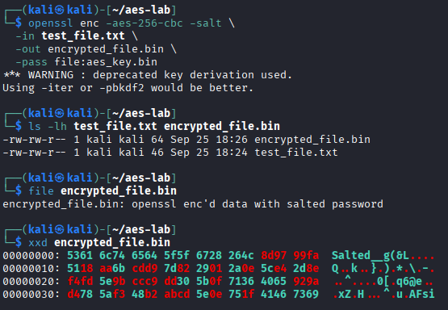

# AES-256 File Encryption and Validation with OpenSSL

## Executive Summary

This investigation demonstrates symmetric file encryption and decryption using OpenSSL and AES-256-CBC.

The exercise began with a guided encryption workflow, including secret generation, ciphertext inspection, decryption, and recovery verification.

An independent investigation extended the workflow to protect a simulated credentials file. The encryption process was improved using PBKDF2 with 100,000 iterations, followed by ciphertext inspection, an incorrect-key decryption test, and byte-for-byte recovery validation.

The investigation focused on understanding how encryption protects data confidentiality, how password-based key derivation affects an implementation, and why successful decryption should be verified rather than assumed.

## Investigation Scope

The work was conducted in an authorized Linux lab environment using OpenSSL and synthetic test data.

| Component | Implementation |
| --- | --- |
| Encryption algorithm | AES-256 |
| Cipher mode | CBC |
| Tool | OpenSSL |
| Guided exercise | Salted, password-based file encryption |
| Independent exercise | PBKDF2 with 100,000 iterations |
| Verification | SHA-256, `cmp`, `file`, `xxd`, `strings`, and `grep` |
| Test data | Sample plaintext and simulated credentials |

### Investigation Objectives

1. Encrypt and decrypt files using AES-256-CBC.
2. Inspect an encrypted artifact and identify its OpenSSL salted-file structure.
3. Verify that decryption reproduces the original file.
4. Identify and address the deprecated key-derivation warning encountered in the guided exercise.
5. Apply PBKDF2 to derive encryption material from separately stored passphrase material.
6. Test whether recognizable plaintext appears in the ciphertext.
7. Evaluate the limitations of encryption without authenticated integrity protection.

## Evidence Sources and Methodology

### Evidence Sources

The investigation used OpenSSL command output, encrypted-file inspection, cryptographic hashes, and file-comparison results.

Three screenshots preserve selected results from the guided and independent exercises.

### Investigation Methodology

| Phase | Analyst Activity |
| --- | --- |
| Preparation | Create synthetic plaintext and generate secret material |
| Encryption | Encrypt the original file using AES-256-CBC |
| Inspection | Examine the encrypted file's format and visible content |
| Decryption | Recover the original file using the appropriate secret |
| Verification | Compare SHA-256 hashes and file contents |
| Improvement | Replace deprecated password-based key derivation with PBKDF2 |
| Negative testing | Attempt decryption with incorrect secret material |
| Assessment | Document confidentiality observations and security limitations |

### Evidence Standards

The analysis distinguishes successful encryption operations from broader security guarantees.

The presence of an OpenSSL salted-file header and apparently unreadable ciphertext does not independently prove that an encryption implementation is secure.

Matching SHA-256 hashes and a successful `cmp` comparison demonstrate that the recovered file matched the original during the test.

An unsuccessful incorrect-key decryption attempt does not establish authenticated encryption. AES-CBC alone does not detect all unauthorized ciphertext modifications.

## Investigation Organization

The report documents three findings:

1. AES-256-CBC Encryption and Ciphertext Inspection
2. Decryption and File Recovery Verification
3. Independent PBKDF2 Encryption and Validation

The final sections will summarize the security implications, evidence limitations, skills demonstrated, and supporting screenshots.

## Investigation Findings

### Finding 1 — AES-256-CBC Encryption and Ciphertext Inspection

#### Investigation Context

The first exercise examined file encryption using OpenSSL and AES-256 in Cipher Block Chaining (CBC) mode.

The objective was to encrypt a plaintext file, inspect the resulting encrypted artifact, and determine what information could be observed without decrypting it.

#### Encryption Procedure

I encrypted a sample text file using OpenSSL:

```bash
openssl enc -aes-256-cbc -salt \
  -in test_file.txt \
  -out encrypted_file.bin \
  -pass file:aes_key.bin
```

The command used AES-256-CBC, enabled salting, and read password material from `aes_key.bin`.

The `-pass file:` option supplies passphrase material for OpenSSL's password-based key derivation. It does not directly load a raw AES-256 encryption key.

#### Encrypted File Inspection

Following encryption, I inspected the original and encrypted files.

| Field | Observed Result |
| --- | --- |
| Original file | `test_file.txt` |
| Original file size | 46 bytes |
| Encrypted file | `encrypted_file.bin` |
| Encrypted file size | 64 bytes |
| File identification | `openssl enc'd data with salted password` |
| Hex inspection command | `xxd encrypted_file.bin` |
| Header | `Salted__` |
| Header bytes | `53616c7465645f5f` |



*Figure 1 — OpenSSL AES-256-CBC encryption of a sample file, showing the deprecated key-derivation warning, file-size comparison, salted file identification, and `Salted__` header in the hexadecimal output.*

The encrypted file began with OpenSSL's `Salted__` marker, followed by salt bytes and ciphertext.

The encrypted artifact was larger than the original because the OpenSSL salted format includes an 8-byte marker, an 8-byte salt, and block-aligned encrypted data.

The hexadecimal inspection showed that the output was not stored as ordinary readable plaintext.

However, a salted header and unreadable bytes alone do not prove that the encryption configuration is secure.

#### Key-Derivation Warning

During encryption, OpenSSL displayed the following warning:

```text
*** WARNING : deprecated key derivation used.
Using -iter or -pbkdf2 would be better.
```

The command used OpenSSL's legacy password-based derivation behavior rather than explicitly enabling PBKDF2.

This warning identified an improvement opportunity addressed in the independent investigation.

#### Security Relevance

Symmetric encryption helps protect stored information against unauthorized disclosure when suitable algorithms, key derivation, and secret-management practices are used.

File inspection can help identify whether an artifact was processed by an encryption utility and what format was produced.

Nevertheless, confirming an encrypted file format does not independently establish confidentiality against every threat or provide ciphertext integrity protection.

#### Analyst Assessment

**Assessment: AES-256-CBC encryption successfully produced an OpenSSL salted ciphertext artifact.**

The original 46-byte plaintext file was converted into a 64-byte encrypted artifact containing the OpenSSL salted-file header.

The encryption command also generated a deprecated key-derivation warning, motivating the subsequent PBKDF2 implementation.