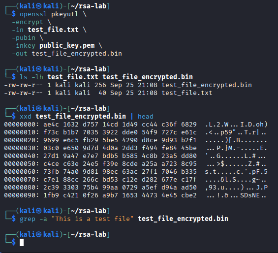
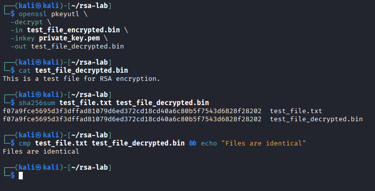

# RSA Asymmetric Encryption and Hybrid File Protection

## Executive Summary

This investigation demonstrates asymmetric encryption using RSA and OpenSSL, followed by an independent experiment exploring the limitations of direct RSA encryption and the use of hybrid cryptography.

The guided exercise involved generating a 2048-bit RSA key pair, encrypting a small plaintext file with the public key, and recovering it with the corresponding private key.

The independent investigation extended the exercise by attempting to encrypt a 1 KiB file directly with RSA. OpenSSL rejected the operation with a `data too large for key size` error.

To address this limitation, I implemented a hybrid encryption workflow using AES-256-CBC to encrypt the larger file and RSA to protect the smaller AES passphrase material. The encrypted passphrase was subsequently recovered using the RSA private key, allowing the original file to be decrypted.

Successful recovery was validated through matching SHA-256 hashes and a direct file comparison.

The investigation demonstrates how asymmetric and symmetric encryption complement each other in practical data-protection workflows.

## Investigation Scope

The investigation was conducted in an authorized Linux lab environment using OpenSSL and synthetic test data.

| Component | Implementation |
| --- | --- |
| Asymmetric algorithm | RSA |
| RSA key length | 2048 bits |
| Symmetric algorithm | AES-256-CBC |
| Key derivation | PBKDF2 with 100,000 iterations |
| Cryptographic utility | OpenSSL |
| Guided exercise | RSA key generation and small-file encryption/decryption |
| Independent exercise | RSA size-limit testing and hybrid encryption |
| Verification | SHA-256 and `cmp` |
| Test data | Small plaintext file and 1 KiB random file |

### Investigation Objectives

1. Generate an RSA private key and derive the corresponding public key.
2. Encrypt a small plaintext file using the RSA public key.
3. Recover the original file using the RSA private key.
4. Verify successful file recovery.
5. Investigate RSA's direct-encryption message-size limitation.
6. Implement a hybrid RSA/AES encryption workflow.
7. Validate recovery of the AES passphrase and encrypted file.
8. Evaluate the security limitations of the demonstrated implementation.

## Evidence Sources and Methodology

### Evidence Sources

The investigation used OpenSSL command output, generated cryptographic artifacts, file-size observations, error messages, SHA-256 hashes, and direct file-comparison results.

Three screenshots document the guided RSA operations and independent hybrid-encryption experiment.

### Investigation Methodology

| Phase | Analyst Activity |
| --- | --- |
| Key generation | Generate RSA private and public keys |
| RSA encryption | Encrypt a small file using the public key |
| RSA decryption | Recover plaintext using the private key |
| Validation | Compare original and recovered file contents |
| Size-limit testing | Attempt direct RSA encryption of a 1 KiB file |
| Hybrid encryption | Encrypt bulk data with AES and protect passphrase material with RSA |
| Hybrid recovery | Recover the AES passphrase, decrypt the file, and verify the result |
| Assessment | Evaluate cryptographic design considerations and limitations |

### Evidence Standards

The analysis distinguishes successful cryptographic operations from broader security guarantees.

A successful RSA encryption operation does not establish that RSA is appropriate for arbitrary-size data.

The 2048-bit RSA key produces a 256-byte RSA ciphertext block, but padding reduces the maximum plaintext size accepted by a single encryption operation.

The independent hybrid workflow demonstrated recovery of the original test data. It was not designed or assessed as a production-ready secure file format.

AES-CBC does not inherently authenticate ciphertext, and matching hashes calculated after recovery do not replace authenticated encryption.

The investigation also distinguishes encryption of a passphrase from direct encryption of a raw AES key.

## Investigation Organization

The report documents three findings:

1. RSA Key Generation and Public-Key Encryption
2. RSA Private-Key Decryption and Recovery Verification
3. Independent RSA Size-Limit Testing and Hybrid Encryption

The final sections consolidate security implications, evidence limitations, skills demonstrated, and supporting screenshots.

## Investigation Findings

### Finding 1 — RSA Key Generation and Public-Key Encryption

#### Investigation Context

The first exercise demonstrated asymmetric encryption using RSA and OpenSSL.

The objective was to generate an RSA public/private key pair, encrypt a small plaintext file using the public key, and inspect the resulting ciphertext.

Unlike symmetric encryption, which uses the same secret key for encryption and decryption, RSA uses mathematically related public and private keys.

#### RSA Key Generation

Following the lab procedure, I generated a 2048-bit RSA private key:

```bash
openssl genpkey -algorithm RSA \
  -out private_key.pem \
  -pkeyopt rsa_keygen_bits:2048
```

I then extracted the corresponding public key:

```bash
openssl rsa -pubout \
  -in private_key.pem \
  -out public_key.pem
```

| Artifact | Purpose |
| --- | --- |
| `private_key.pem` | Private key used for decryption |
| `public_key.pem` | Public key used for encryption |

The public key can be distributed to an intended sender, while the private key must remain protected.

The key-generation commands are documented in the original exercise instructions; Figure 1 focuses on the subsequent encryption results rather than the key-generation output.

#### Public-Key Encryption

I encrypted a small test file using the RSA public key:

```bash
openssl pkeyutl \
  -encrypt \
  -in test_file.txt \
  -pubin \
  -inkey public_key.pem \
  -out test_file_encrypted.bin
```

The `-pubin` option identifies `public_key.pem` as a public key, while `-encrypt` performs the public-key encryption operation.

The file-size comparison returned:

| File | Size | Description |
| --- | ---: | --- |
| `test_file.txt` | 40 bytes | Original plaintext |
| `test_file_encrypted.bin` | 256 bytes | RSA ciphertext |



*Figure 1 — OpenSSL RSA public-key encryption of a 40-byte plaintext file into a 256-byte ciphertext artifact. Hexadecimal inspection displayed binary output, and a search for the original plaintext phrase returned no match.*

The 256-byte encrypted output is consistent with the modulus size of a 2048-bit RSA key.

This does not mean RSA can encrypt an arbitrary 256-byte plaintext in a single operation. RSA padding reduces the maximum message size.

#### Ciphertext Inspection

I inspected the encrypted output:

```bash
xxd test_file_encrypted.bin | head
```

The command displayed binary ciphertext in hexadecimal format.

I then searched the encrypted file for a recognizable phrase from the original plaintext:

```bash
grep -a "This is a test file" test_file_encrypted.bin
```

No matching plaintext was returned.

The inspection demonstrated that the tested phrase was not visibly preserved in the ciphertext.

However, the absence of readable plaintext is not sufficient to establish the cryptographic security of an implementation.

#### Security Relevance

Public-key encryption allows a sender to encrypt data without possessing the recipient's private decryption key.

This supports secure communication and key-distribution workflows when RSA is used with appropriate padding, key management, and cryptographic configuration.

RSA is not typically used to encrypt large files directly because a single RSA encryption operation has a strict plaintext size limit.

The independent investigation will examine that limitation and demonstrate a hybrid approach combining RSA and AES.

#### Analyst Assessment

**Assessment: Small-file RSA public-key encryption successfully demonstrated.**

The 40-byte plaintext file was encrypted into a 256-byte RSA ciphertext artifact using the public key.

Hexadecimal inspection and a plaintext-string search provided supporting evidence that the encrypted artifact differed from the original readable file.

The result established a working small-file RSA encryption operation but did not independently validate decryption, authenticity, or suitability for larger files.

### Finding 2 — RSA Private-Key Decryption and Recovery Verification

#### Investigation Context

The second exercise focused on recovering a previously encrypted file using the RSA private key.

The objective was to verify that data encrypted with the RSA public key could be decrypted using the corresponding private key and that the recovered file matched the original plaintext.

#### Private-Key Decryption

I decrypted the RSA ciphertext using OpenSSL:

```bash
openssl pkeyutl \
  -decrypt \
  -in test_file_encrypted.bin \
  -inkey private_key.pem \
  -out test_file_decrypted.bin
```

The `-decrypt` option performed the private-key decryption operation using `private_key.pem`.

The command produced `test_file_decrypted.bin`, containing the recovered plaintext.

#### Plaintext Recovery

I inspected the decrypted file:

```bash
cat test_file_decrypted.bin
```

The output was:

```text
This is a test file for RSA encryption.
```

This demonstrated that the RSA private key successfully recovered the plaintext encrypted during the previous exercise.

#### SHA-256 Recovery Verification

To validate the recovered contents, I calculated SHA-256 hashes for the original and decrypted files:

```bash
sha256sum test_file.txt test_file_decrypted.bin
```

Both files returned the same SHA-256 digest:

```text
f07a9fce5695d3f3dffad81079d6ed372cd18cd40a6c80b5f7543d6828f28202
```

| File | Verification Result |
| --- | --- |
| `test_file.txt` | Original plaintext reference |
| `test_file_decrypted.bin` | Matching SHA-256 digest |
| Comparison | No differences detected by hash comparison |

#### Byte-for-Byte Verification

I performed an additional comparison using `cmp`:

```bash
cmp test_file.txt test_file_decrypted.bin && echo "Files are identical"
```

The command returned:

```text
Files are identical
```



*Figure 2 — OpenSSL RSA private-key decryption recovering the original plaintext. Matching SHA-256 hashes and a successful `cmp` comparison confirm that the original and recovered files contain identical data.*

The successful comparison confirmed that the recovered file contained the same bytes as the original plaintext.

Together, the SHA-256 and `cmp` results provided evidence of accurate file recovery rather than relying solely on the absence of an OpenSSL error.

#### Security Relevance

Asymmetric encryption separates the key used for encryption from the private key required for decryption.

In this exercise, the public key was used to encrypt the original file, while the private key recovered its contents.

This separation is useful in secure key-distribution and hybrid-encryption workflows, where sensitive decryption material should not be shared with the sender.

However, successful decryption and matching file hashes do not independently establish the sender's identity or demonstrate authenticated integrity protection.

#### Analyst Assessment

**Assessment: RSA private-key decryption successfully recovered the original plaintext.**

The recovered file contained the expected message, produced an identical SHA-256 digest, and passed a direct byte-for-byte comparison.

This confirmed successful RSA encryption and decryption for the small test file and established a baseline for the independent hybrid-encryption investigation.