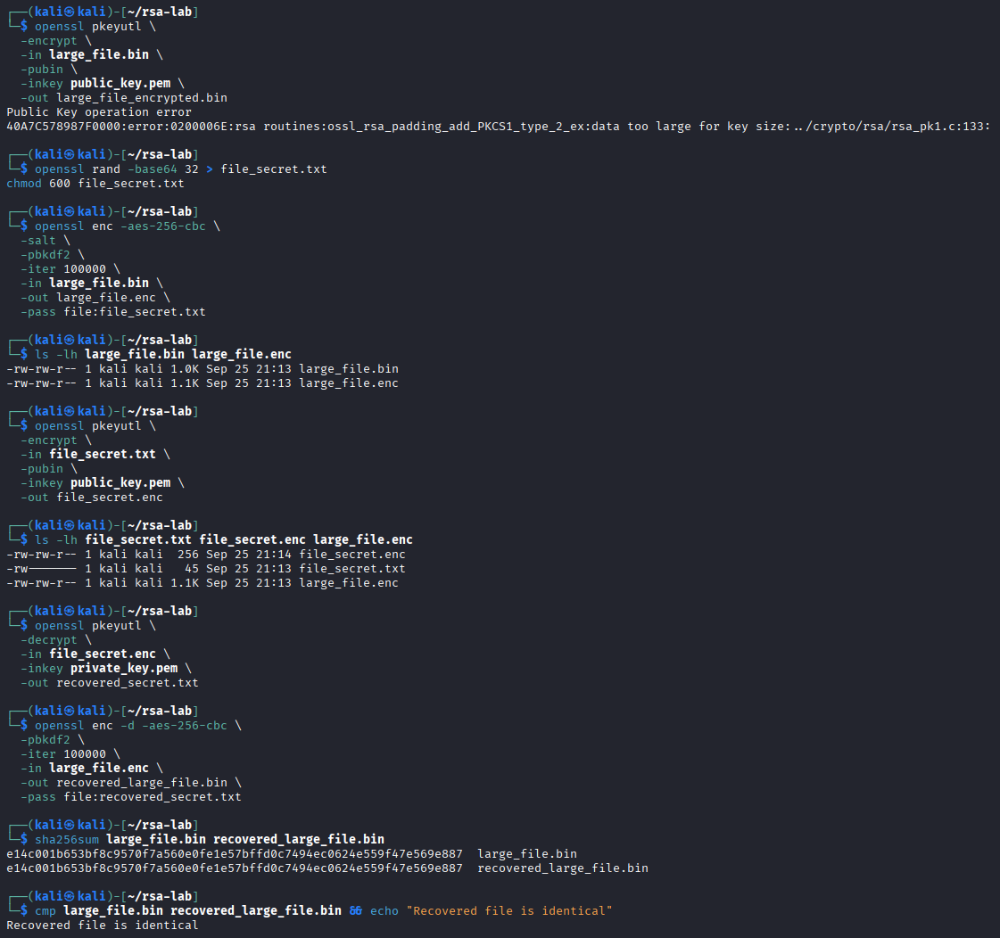

# RSA Asymmetric Encryption and Hybrid File Protection

## Executive Summary

This investigation demonstrates asymmetric encryption using RSA and OpenSSL, followed by an independent experiment exploring the limitations of direct RSA encryption and the use of hybrid cryptography.

The guided exercise involved generating a 2048-bit RSA key pair, encrypting a small plaintext file with the public key, and recovering it with the corresponding private key.

The independent investigation extended the exercise by attempting to encrypt a 1 KiB file directly with RSA. OpenSSL rejected the operation with a `data too large for key size` error.

To address this limitation, I implemented a hybrid encryption workflow using AES-256-CBC to encrypt the larger file and RSA to protect the smaller AES passphrase material. The encrypted passphrase was subsequently recovered using the RSA private key, allowing the original file to be decrypted.

Successful recovery was validated through matching SHA-256 hashes and a direct file comparison.

The investigation demonstrates how asymmetric and symmetric encryption complement each other in practical data-protection workflows.

## Investigation Scope

The investigation was conducted in an authorized Linux lab environment using OpenSSL and synthetic test data.

| Component | Implementation |
| --- | --- |
| Asymmetric algorithm | RSA |
| RSA key length | 2048 bits |
| Symmetric algorithm | AES-256-CBC |
| Key derivation | PBKDF2 with 100,000 iterations |
| Cryptographic utility | OpenSSL |
| Guided exercise | RSA key generation and small-file encryption/decryption |
| Independent exercise | RSA size-limit testing and hybrid encryption |
| Verification | SHA-256 and `cmp` |
| Test data | Small plaintext file and 1 KiB random file |

### Investigation Objectives

1. Generate an RSA private key and derive the corresponding public key.
2. Encrypt a small plaintext file using the RSA public key.
3. Recover the original file using the RSA private key.
4. Verify successful file recovery.
5. Investigate RSA's direct-encryption message-size limitation.
6. Implement a hybrid RSA/AES encryption workflow.
7. Validate recovery of the AES passphrase and encrypted file.
8. Evaluate the security limitations of the demonstrated implementation.

## Evidence Sources and Methodology

### Evidence Sources

The investigation used OpenSSL command output, generated cryptographic artifacts, file-size observations, error messages, SHA-256 hashes, and direct file-comparison results.

Three screenshots document the guided RSA operations and independent hybrid-encryption experiment.

### Investigation Methodology

| Phase | Analyst Activity |
| --- | --- |
| Key generation | Generate RSA private and public keys |
| RSA encryption | Encrypt a small file using the public key |
| RSA decryption | Recover plaintext using the private key |
| Validation | Compare original and recovered file contents |
| Size-limit testing | Attempt direct RSA encryption of a 1 KiB file |
| Hybrid encryption | Encrypt bulk data with AES and protect passphrase material with RSA |
| Hybrid recovery | Recover the AES passphrase, decrypt the file, and verify the result |
| Assessment | Evaluate cryptographic design considerations and limitations |

### Evidence Standards

The analysis distinguishes successful cryptographic operations from broader security guarantees.

A successful RSA encryption operation does not establish that RSA is appropriate for arbitrary-size data.

The 2048-bit RSA key produces a 256-byte RSA ciphertext block, but padding reduces the maximum plaintext size accepted by a single encryption operation.

The independent hybrid workflow demonstrated recovery of the original test data. It was not designed or assessed as a production-ready secure file format.

AES-CBC does not inherently authenticate ciphertext, and matching hashes calculated after recovery do not replace authenticated encryption.

The investigation also distinguishes encryption of a passphrase from direct encryption of a raw AES key.

## Investigation Organization

The report documents three findings:

1. RSA Key Generation and Public-Key Encryption
2. RSA Private-Key Decryption and Recovery Verification
3. Independent RSA Size-Limit Testing and Hybrid Encryption

The final sections consolidate security implications, evidence limitations, skills demonstrated, and supporting screenshots.

## Investigation Findings

### Finding 1 — RSA Key Generation and Public-Key Encryption

#### Investigation Context

The first exercise demonstrated asymmetric encryption using RSA and OpenSSL.

The objective was to generate an RSA public/private key pair, encrypt a small plaintext file using the public key, and inspect the resulting ciphertext.

Unlike symmetric encryption, which uses the same secret key for encryption and decryption, RSA uses mathematically related public and private keys.

#### RSA Key Generation

Following the lab procedure, I generated a 2048-bit RSA private key:

```bash
openssl genpkey -algorithm RSA \
  -out private_key.pem \
  -pkeyopt rsa_keygen_bits:2048
```

I then extracted the corresponding public key:

```bash
openssl rsa -pubout \
  -in private_key.pem \
  -out public_key.pem
```

| Artifact | Purpose |
| --- | --- |
| `private_key.pem` | Private key used for decryption |
| `public_key.pem` | Public key used for encryption |

The public key can be distributed to an intended sender, while the private key must remain protected.

The key-generation commands are documented in the original exercise instructions; Figure 1 focuses on the subsequent encryption results rather than the key-generation output.

#### Public-Key Encryption

I encrypted a small test file using the RSA public key:

```bash
openssl pkeyutl \
  -encrypt \
  -in test_file.txt \
  -pubin \
  -inkey public_key.pem \
  -out test_file_encrypted.bin
```

The `-pubin` option identifies `public_key.pem` as a public key, while `-encrypt` performs the public-key encryption operation.

The file-size comparison returned:

| File | Size | Description |
| --- | ---: | --- |
| `test_file.txt` | 40 bytes | Original plaintext |
| `test_file_encrypted.bin` | 256 bytes | RSA ciphertext |


*Figure 1 — OpenSSL RSA public-key encryption of a 40-byte plaintext file into a 256-byte ciphertext artifact. Hexadecimal inspection displayed binary output, and a search for the original plaintext phrase returned no match.*

The 256-byte encrypted output is consistent with the modulus size of a 2048-bit RSA key.

This does not mean RSA can encrypt an arbitrary 256-byte plaintext in a single operation. RSA padding reduces the maximum message size.

#### Ciphertext Inspection

I inspected the encrypted output:

```bash
xxd test_file_encrypted.bin | head
```

The command displayed binary ciphertext in hexadecimal format.

I then searched the encrypted file for a recognizable phrase from the original plaintext:

```bash
grep -a "This is a test file" test_file_encrypted.bin
```

No matching plaintext was returned.

The inspection demonstrated that the tested phrase was not visibly preserved in the ciphertext.

However, the absence of readable plaintext is not sufficient to establish the cryptographic security of an implementation.

#### Security Relevance

Public-key encryption allows a sender to encrypt data without possessing the recipient's private decryption key.

This supports secure communication and key-distribution workflows when RSA is used with appropriate padding, key management, and cryptographic configuration.

RSA is not typically used to encrypt large files directly because a single RSA encryption operation has a strict plaintext size limit.

The independent investigation will examine that limitation and demonstrate a hybrid approach combining RSA and AES.

#### Analyst Assessment

**Assessment: Small-file RSA public-key encryption successfully demonstrated.**

The 40-byte plaintext file was encrypted into a 256-byte RSA ciphertext artifact using the public key.

Hexadecimal inspection and a plaintext-string search provided supporting evidence that the encrypted artifact differed from the original readable file.

The result established a working small-file RSA encryption operation but did not independently validate decryption, authenticity, or suitability for larger files.

### Finding 2 — RSA Private-Key Decryption and Recovery Verification

#### Investigation Context

The second exercise focused on recovering a previously encrypted file using the RSA private key.

The objective was to verify that data encrypted with the RSA public key could be decrypted using the corresponding private key and that the recovered file matched the original plaintext.

#### Private-Key Decryption

I decrypted the RSA ciphertext using OpenSSL:

```bash
openssl pkeyutl \
  -decrypt \
  -in test_file_encrypted.bin \
  -inkey private_key.pem \
  -out test_file_decrypted.bin
```

The `-decrypt` option performed the private-key decryption operation using `private_key.pem`.

The command produced `test_file_decrypted.bin`, containing the recovered plaintext.

#### Plaintext Recovery

I inspected the decrypted file:

```bash
cat test_file_decrypted.bin
```

The output was:

```text
This is a test file for RSA encryption.
```

This demonstrated that the RSA private key successfully recovered the plaintext encrypted during the previous exercise.

#### SHA-256 Recovery Verification

To validate the recovered contents, I calculated SHA-256 hashes for the original and decrypted files:

```bash
sha256sum test_file.txt test_file_decrypted.bin
```

Both files returned the same SHA-256 digest:

```text
f07a9fce5695d3f3dffad81079d6ed372cd18cd40a6c80b5f7543d6828f28202
```

| File | Verification Result |
| --- | --- |
| `test_file.txt` | Original plaintext reference |
| `test_file_decrypted.bin` | Matching SHA-256 digest |
| Comparison | No differences detected by hash comparison |

#### Byte-for-Byte Verification

I performed an additional comparison using `cmp`:

```bash
cmp test_file.txt test_file_decrypted.bin && echo "Files are identical"
```

The command returned:

```text
Files are identical
```


*Figure 2 — OpenSSL RSA private-key decryption recovering the original plaintext. Matching SHA-256 hashes and a successful `cmp` comparison confirm that the original and recovered files contain identical data.*

The successful comparison confirmed that the recovered file contained the same bytes as the original plaintext.

Together, the SHA-256 and `cmp` results provided evidence of accurate file recovery rather than relying solely on the absence of an OpenSSL error.

#### Security Relevance

Asymmetric encryption separates the key used for encryption from the private key required for decryption.

In this exercise, the public key was used to encrypt the original file, while the private key recovered its contents.

This separation is useful in secure key-distribution and hybrid-encryption workflows, where sensitive decryption material should not be shared with the sender.

However, successful decryption and matching file hashes do not independently establish the sender's identity or demonstrate authenticated integrity protection.

#### Analyst Assessment

**Assessment: RSA private-key decryption successfully recovered the original plaintext.**

The recovered file contained the expected message, produced an identical SHA-256 digest, and passed a direct byte-for-byte comparison.

This confirmed successful RSA encryption and decryption for the small test file and established a baseline for the independent hybrid-encryption investigation.

### Finding 3 — Independent RSA Size-Limit Testing and Hybrid Encryption

#### Investigation Context

To extend the guided RSA exercise, I investigated whether RSA could directly encrypt a larger file.

The previous exercises demonstrated successful public-key encryption and private-key decryption of a small plaintext file. The independent investigation tested the limitations of that approach using a 1 KiB file.

After observing an RSA encryption failure, I implemented a hybrid workflow combining RSA and AES-256-CBC to protect the larger file.

The objective was to understand why bulk data encryption is normally performed with symmetric cryptography and how asymmetric encryption can be used to protect the smaller secret material required for recovery.

#### Direct RSA Encryption Size Limitation

I first attempted to encrypt `large_file.bin` using the RSA public key:

```bash
openssl pkeyutl \
  -encrypt \
  -in large_file.bin \
  -pubin \
  -inkey public_key.pem \
  -out large_file_encrypted.bin
```

OpenSSL rejected the operation with the error:

```text
Public Key operation error
rsa routines:ossl_rsa_padding_add_PKCS1_type_2_ex:
data too large for key size
```

The file was approximately 1 KiB, exceeding the maximum plaintext size supported by a single RSA encryption operation using the configured key and padding.

With a 2048-bit RSA key and PKCS#1 v1.5 encryption padding, the maximum plaintext size is 245 bytes.

The failed operation demonstrated a practical limitation of direct RSA encryption rather than a failure of the RSA key pair.

#### Hybrid Encryption Design

To address the size limitation, I implemented a two-part encryption workflow:

1. Encrypt the larger file using AES-256-CBC.
2. Encrypt the AES passphrase material using the RSA public key.

The recipient can reverse the process by recovering the passphrase with the RSA private key and using it to decrypt the AES ciphertext.

This approach separates bulk-data encryption from protection of the smaller secret required for decryption.

#### AES Encryption of the Larger File

I generated random passphrase material and restricted access to its file:

```bash
openssl rand -base64 32 > file_secret.txt
chmod 600 file_secret.txt
```

I then encrypted the larger file:

```bash
openssl enc -aes-256-cbc \
  -salt \
  -pbkdf2 \
  -iter 100000 \
  -in large_file.bin \
  -out large_file.enc \
  -pass file:file_secret.txt
```

The command used AES-256-CBC with PBKDF2 and 100,000 iterations.

| Artifact | Observed Size | Purpose |
| --- | --- | --- |
| `large_file.bin` | 1.0 KiB | Original test data |
| `large_file.enc` | 1.1 KiB | AES-encrypted file |
| `file_secret.txt` | 45 bytes | Random passphrase material |

The encrypted output was larger than the original due to the salted file format and block-aligned ciphertext.

#### RSA Protection of the AES Passphrase

After encrypting the file with AES, I encrypted the smaller passphrase file using the RSA public key:

```bash
openssl pkeyutl \
  -encrypt \
  -in file_secret.txt \
  -pubin \
  -inkey public_key.pem \
  -out file_secret.enc
```

The resulting `file_secret.enc` artifact was 256 bytes, consistent with the RSA key's 2048-bit modulus.

| Artifact | Size | Purpose |
| --- | --- | --- |
| `file_secret.txt` | 45 bytes | Original passphrase material |
| `file_secret.enc` | 256 bytes | RSA-encrypted passphrase |

This operation succeeded because the passphrase file was small enough to fit within the RSA encryption operation's message-size limit.

The workflow encrypted passphrase material rather than directly wrapping a raw AES key.

#### RSA Private-Key Recovery

I recovered the passphrase material using the RSA private key:

```bash
openssl pkeyutl \
  -decrypt \
  -in file_secret.enc \
  -inkey private_key.pem \
  -out recovered_secret.txt
```

The command completed and produced the recovered passphrase file.

I then used the recovered passphrase to decrypt the AES-protected data:

```bash
openssl enc -d -aes-256-cbc \
  -pbkdf2 \
  -iter 100000 \
  -in large_file.enc \
  -out recovered_large_file.bin \
  -pass file:recovered_secret.txt
```

The operation successfully recovered the larger file without attempting to decrypt the bulk data directly with RSA.

#### Recovery Verification

To verify recovery, I calculated SHA-256 hashes for the original and recovered files:

```bash
sha256sum large_file.bin recovered_large_file.bin
```

Both files produced the same SHA-256 digest:

```text
e14c001b653bf8c9570f7a560e0fe1e57bffd0c7494ec0624e559f47e569e887
```

I also performed a byte-for-byte comparison:

```bash
cmp large_file.bin recovered_large_file.bin &&
  echo "Recovered file is identical"
```

The output confirmed:

```text
Recovered file is identical
```

| Verification | Result |
| --- | --- |
| Direct RSA encryption of larger file | Failed due to message-size limitation |
| AES-256-CBC encryption | Completed |
| RSA encryption of passphrase | Completed |
| RSA private-key passphrase recovery | Completed |
| AES file decryption | Completed |
| SHA-256 comparison | Matching digests |
| `cmp` comparison | Files identical |



*Figure 3 — Independent RSA/AES hybrid encryption exercise showing the RSA message-size error, AES-256-CBC encryption with PBKDF2, RSA protection and recovery of passphrase material, and successful file recovery validated by matching SHA-256 hashes and `cmp`.*

The matching hashes and successful comparison confirmed that the hybrid workflow recovered the original file without observed content changes.

#### Security Relevance

Hybrid encryption combines the efficiency of symmetric encryption for bulk data with the public/private key separation provided by asymmetric encryption.

The independent exercise demonstrated why RSA should not be used directly to encrypt arbitrary-size files.

It also demonstrated a practical recovery workflow in which the RSA private key was required to recover the secret material used for AES decryption.

However, this implementation was a learning exercise rather than a production-ready cryptographic file format.

The `openssl pkeyutl` commands used default RSA encryption padding, and the AES-CBC ciphertext did not include authenticated integrity protection.

A production design would require appropriate RSA padding, such as OAEP, an authenticated encryption scheme, secure private-key storage, and careful handling of recovered secret material.

#### Analyst Assessment

**Assessment: RSA's direct-encryption size limitation identified and a hybrid RSA/AES encryption workflow successfully validated.**

The initial RSA operation failed when attempting to encrypt the 1 KiB file.

The hybrid approach successfully encrypted the larger file using AES-256-CBC, protected the passphrase material using RSA, and recovered the original file using the corresponding private key.

Matching SHA-256 hashes and a byte-for-byte comparison confirmed successful recovery in the controlled test.

The investigation demonstrated both the practical value of hybrid encryption and the importance of distinguishing successful cryptographic operations from production-level security guarantees.

## Security Implications

The investigation demonstrated how RSA and AES can serve complementary purposes in a file-encryption workflow.

| Security Area | Observation | Security Implication |
| --- | --- | --- |
| Asymmetric encryption | RSA public-key encryption successfully protected a small test file | Data can be encrypted using a recipient's public key without sharing the corresponding private key |
| Private-key recovery | RSA decryption recovered the original plaintext | Access to the corresponding private key is necessary for the demonstrated recovery process |
| RSA message-size limitation | Direct encryption of a 1 KiB file failed | RSA is not suitable for direct encryption of arbitrary-size files |
| Symmetric encryption | AES-256-CBC encrypted the larger file | Symmetric cryptography can efficiently protect bulk data |
| Hybrid encryption | RSA protected AES passphrase material | Asymmetric encryption can protect the smaller secret required for symmetric decryption |
| Password-based derivation | PBKDF2 used 100,000 iterations | Password-based encryption can use configurable derivation costs |
| Recovery verification | SHA-256 and `cmp` confirmed identical files | Independent verification supports confidence in successful recovery |
| Cryptographic integrity | AES-CBC did not provide authenticated encryption | Successful decryption must not be confused with tamper resistance |

### RSA Padding Considerations

The guided and independent RSA exercises used OpenSSL's `pkeyutl` encryption and decryption operations.

The direct-encryption size-limit error identified PKCS#1 v1.5 encryption padding. For a 2048-bit RSA key, this permits a maximum plaintext size of 245 bytes in one operation.

Although the exercise demonstrated successful encryption and decryption, PKCS#1 v1.5 encryption padding is not the preferred choice for new cryptographic designs.

A production-oriented implementation should consider RSA-OAEP with an appropriate hash configuration and a well-defined encrypted-data format.

The investigation did not implement or compare RSA-OAEP.

### Hybrid Encryption Considerations

The independent workflow used RSA to protect randomly generated passphrase material, while AES-256-CBC encrypted the larger file.

The passphrase was used by OpenSSL's password-based key derivation rather than acting as a raw AES key.

This distinction matters because password-based encryption and direct symmetric-key encryption involve different key-handling and derivation procedures.

A production hybrid-encryption implementation should use an established cryptographic format or library rather than relying on an ad hoc combination of commands.

### Key Management Considerations

The RSA private key was necessary to recover the AES passphrase.

Its confidentiality is therefore critical to protecting the encrypted data.

The investigation demonstrated basic public/private key operations but did not implement enterprise private-key storage, key rotation, revocation, hardware-backed key protection, or centralized key management.

The exercise also did not protect the RSA private key with an additional passphrase or investigate operational key-distribution procedures.

## Evidence Limitations

This investigation was conducted in an authorized Linux lab environment using synthetic test files.

The following limitations apply:

1. **Evidence scope:** Three screenshots preserve selected encryption, decryption, error, and verification output. They do not constitute a complete cryptographic operation log.

2. **Key generation:** The 2048-bit RSA key-generation procedure is documented in the lab instructions, but the preserved screenshots primarily show subsequent cryptographic operations.

3. **RSA size testing:** The independent exercise tested a single 1 KiB file. The failure demonstrates the configured RSA operation's size limitation, not every possible RSA padding configuration.

4. **Padding:** The RSA encryption workflow used PKCS#1 v1.5 padding. RSA-OAEP was not implemented or evaluated.

5. **Hybrid design:** The hybrid workflow combined RSA passphrase encryption with AES-256-CBC file encryption. It was not assessed as a production-ready encrypted-file format.

6. **Integrity protection:** AES-CBC encryption did not provide authenticated ciphertext integrity. Matching recovery hashes and `cmp` results do not establish resistance to malicious modification.

7. **Key management:** The exercise did not evaluate enterprise secret storage, private-key rotation, hardware security modules, or recovery governance.

8. **Security evaluation:** No formal cryptographic audit, vulnerability assessment, or adversarial tampering test was conducted.

## Skills Demonstrated

### Asymmetric Cryptography

- Generated RSA public and private keys using OpenSSL.
- Used public-key encryption to protect a small plaintext file.
- Recovered encrypted data using the corresponding RSA private key.
- Inspected RSA ciphertext size and hexadecimal output.
- Identified the direct RSA encryption message-size limitation.
- Interpreted OpenSSL cryptographic error output.

### Hybrid Encryption

- Implemented AES-256-CBC encryption for larger test data.
- Configured PBKDF2 with 100,000 iterations.
- Used RSA to protect passphrase material required for symmetric decryption.
- Recovered encrypted passphrase material using an RSA private key.
- Used recovered secret material to decrypt a larger file.
- Distinguished passphrase protection from direct AES key wrapping.

### Cryptographic Validation and Security Analysis

- Verified file recovery using SHA-256 hashes.
- Confirmed byte-for-byte equality using `cmp`.
- Examined RSA padding and message-size constraints.
- Distinguished confidentiality from authenticated integrity.
- Evaluated the limitations of custom hybrid-encryption workflows.
- Documented security observations with supporting technical evidence.

## Conclusion

This investigation demonstrated RSA asymmetric encryption, private-key decryption, and a hybrid RSA/AES file-protection workflow using OpenSSL.

The guided exercise established successful encryption and recovery of a small plaintext file.

The independent investigation exposed a practical limitation when direct RSA encryption failed on a 1 KiB file.

By using AES-256-CBC to encrypt the larger file and RSA to protect the smaller passphrase material, the hybrid workflow successfully recovered the original file.

Matching SHA-256 hashes and direct file comparison confirmed that the recovered data matched the original.

The principal outcome was understanding how RSA and AES complement each other while recognizing the importance of appropriate padding, authenticated encryption, and secure key management.

These techniques provide foundational experience relevant to data protection, secure system design, cryptographic troubleshooting, and security engineering.

## Evidence Index

| Figure | Evidence File | Description |
| --- | --- | --- |
| 1 | `01-rsa-public-key-encryption.png` | RSA public-key encryption, ciphertext size, and file inspection |
| 2 | `02-rsa-private-key-decryption.png` | Private-key decryption and SHA-256 recovery verification |
| 3 | `03-hybrid-encryption-validation.png` | RSA size-limit error, hybrid encryption, and successful file recovery |

All screenshots are located in the accompanying [`evidence/`](evidence/) directory.